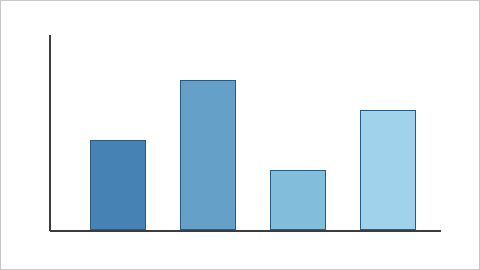

# Introduction

Start writing here. A Markdown project compiles through pandoc into LaTeX, with the built-in Tectonic or your own TeX, or into Typst.

{#fig:example width=60%}

The image above shows a first figure. Replace it with your own image or a diagram.

# Results

The first measurements are below.

Table: First measurements. {#tab:results}

| Measure | Before | After |
| --- | --- | --- |
| Length | 12 mm | 15 mm |
| Width | 8 mm | 10 mm |
| Height | 3 mm | 4 mm |

Cite a source with its key in brackets, as in [@knuth1984].

# References
