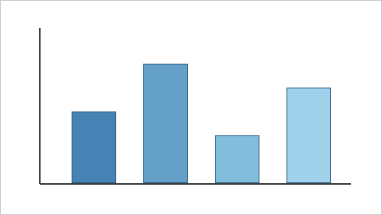

# Introduction {#sec:intro}

State the question the report answers and why it matters. @sec:method says how it was answered and @sec:results what was found.

# Method {#sec:method}

Describe what was measured and how, so that someone else could do it again. The steps are drawn in @fig:steps.

```{.mermaid caption="From measurement to report" #fig:steps}
graph LR
  A[Measure] --> B[Record]
  B --> C[Analyse]
  C --> D[Report]
```

The flow rate follows from the speed and the area of the pipe, as @eq:flow gives.

$$ Q = v A $$ {#eq:flow}

# Results {#sec:results}

@tbl:measures lists the first measurements and @fig:example shows them.

Table: First measurements. {#tbl:measures}

| Measure | Before | After |
| --- | --- | --- |
| Length | 12 mm | 15 mm |
| Width | 8 mm | 10 mm |
| Height | 3 mm | 4 mm |

{#fig:example width=60%}

# Discussion

Explain what the results mean, compare them with earlier work [@Knuth1984] and say what limits them.

# Conclusion

Answer the question from @sec:intro in a few sentences.

# References
