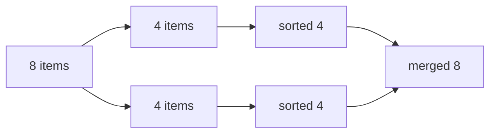

# The problem

## Sorting is everywhere

- Search results, inboxes and leaderboards are all sorted lists.
- A slow sort is fine for ten items and hopeless for ten million.
- The question for today: **how does the work grow with the list?**

# Two algorithms

## Insertion sort

```python
def insertion_sort(items):
    for i in range(1, len(items)):
        j = i
        while j > 0 and items[j - 1] > items[j]:
            items[j - 1], items[j] = items[j], items[j - 1]
            j -= 1
    return items
```

Each item slides left until it is in place.

## How much work is insertion sort?

In the worst case item $i$ is compared with all $i$ items before it:

$$ C(n) = \sum_{i=1}^{n-1} i = \frac{n(n-1)}{2}. $$

Doubling the list roughly **quadruples** the work.

## Merge sort



Halve the list, sort each half, then merge them: $T(n) = n \log_2 n$.

# Measuring them

## Comparisons as the list grows

| Items | Insertion sort | Merge sort |
| ---: | ---: | ---: |
| 10 | 45 | 34 |
| 1,000 | 499,500 | 9,966 |
| 1,000,000 | about $5 \times 10^{11}$ | about $2 \times 10^7$ |

## What to remember

- Insertion sort grows like $n^2$, merge sort like $n \log n$.
- For short lists either will do; for long lists the difference is days.
